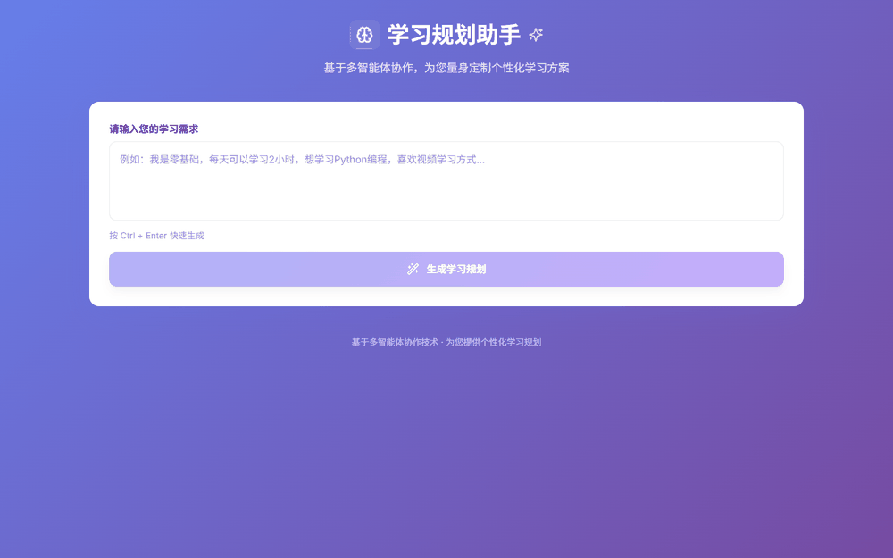
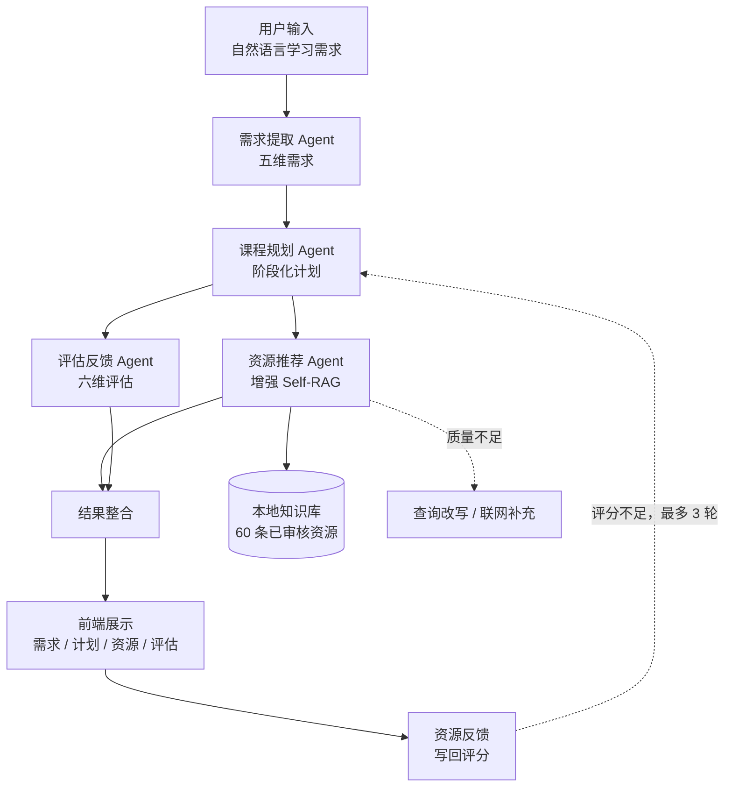

# 多智能体学习规划助手


**一句话需求 → 阶段化学习计划 + 可溯源资源清单 + 六维评估，四个 Agent 用 LangGraph 编排，评估不达标回环重生成（≤3 轮）。**
检索链路：BGE 稠密 + BM25 稀疏双路召回 → RRF 融合（只看名次，免归一化）→ Cross-Encoder 精排 → 置信度门控。
留精排不是为了排序：它在这个语料上是负收益（Hit@1 0.9072 → 0.8866，延迟 9 → 365 ms），留它是给质量门控提供置信度信号；
排序端加 0.55 阈值门控后 Hit@1 回到 0.9175，门控本身只多 0.1 ms；质量仍不足才改写重查、兜底联网。
效果靠 97 道自建题 + 十档消融 + RAGAS 四指标 + 113 项 CI 测试说话，失败分析与已知偏差一并写在报告里。

---



*60 秒跑完一轮完整链路（真实后端，无 mock）：输入需求 → 需求分析五字段 → 4 阶段计划 → 资源列表与检索诊断条（来源 / 质量分 / 候选数 / 重排状态）→ 六维评估 → 提交反馈后评分与反馈条数当场回写。*
*逐帧讲解词与另外两个用例见 [docs/demo-script.md](docs/demo-script.md)。*

---

## 它解决什么问题

| 自学的真实困境 | 这个项目怎么处理 |
|---|---|
| 知道要学什么，不知道 3 个月怎么拆、每周做什么 | 需求提取 → 阶段化计划，按每日可用时长和时间期望算总学时 |
| 网上一搜全是广告和过期链接，难度还对不上 | 本地 60 条已审核资源，按领域/难度/类型过滤后再做混合检索 |
| 问通用大模型，它会编链接、给一份"通用清单" | 资源必须来自知识库，带 URL 与来源标记；库内不足时才联网补充并标注 |
| 不知道推荐得准不准，也没法改进 | 97 道题的检索指标 + RAGAS 评测 + 十档消融，改动前后可比 |
| 反馈按钮点了没反应，评分永远是 0 | 反馈真实写回资源评分，刷新后卡片上能看到新的星级与条数 |

## 核心亮点

**1. 四个 Agent 的 LangGraph 状态图，带条件重生成**
`extract → plan → (recommend ∥ assess) → merge`。推荐与评估并行执行；评估均分低于 6 分时回到规划阶段重新生成，
最多 3 轮，避免"一次性输出、质量听天由命"。

**2. 混合检索：BGE 稠密 + BM25 稀疏 + 标准 RRF 融合**
RRF 只看名次不看分数分布，省掉归一化这一步。97 道题上 `Hit@1 0.9072 / Hit@5 1.0000 / MRR@5 0.9450`，
加元数据过滤后 `Hit@1 0.9691`。

**3. 重排的负收益被门控抵消**
Cross-Encoder 精排在这个语料上是负收益（Hit@1 −0.02）。做法不是删掉重排，而是加置信度门控：
首位置信度低时保留融合顺序，但照常回填置信度给质量门控用——排序端与质量端解耦后，
`Hit@1 0.8866 → 0.9175`，延迟一点没加。这个取舍和失败分析都写在评测报告里。

**4. 质量门控闭环（Self-RAG）**
检索结果先过 `RAGQualityChecker`：质量不足就改写查询重检，仍不足才联网补充，最后兜底 LLM 生成。
每一步都记录质量分与信号，前端能看到当前走的是哪条路径。

**5. 评测是可复现的，不是口头的**
97 题检索集 + 十档消融脚本 + RAGAS 四指标 + 119 项 pytest（CI 跑其中 113 项，6 项集成测试需本地模型）+ GitHub Actions。
指标口径、已知偏差（例如 `answer_relevancy` 因为被评测的是资源清单模板而偏低）都写在报告里。

## 架构



资源检索链路（详细版见 [ARCHITECTURE.md](docs/ARCHITECTURE.md)）：

```text
查询正向化 → 元数据过滤 → Dense + BM25 → RRF 融合 → Cross-Encoder 精排 → 质量检测
                                                              │
                                     通过 → 输出    不通过 → 改写重检 / 联网补充
```

> 演示：仓库**不提供线上 demo**，全部在本地运行。上面的 GIF 是用 `scripts/record-demo.mjs`
> 驱动无头浏览器跑真实后端抓帧、再由 `scripts/build_demo_gif.py` 合成的，重录命令见
> [docs/demo-script.md](docs/demo-script.md)。

## 技术栈

| 层 | 选型 |
|---|---|
| 编排 | LangGraph 1.2（StateGraph / 条件边 / 并行分支 / MemorySaver） |
| 模型 | DeepSeek Chat（生成与评估）、BGE-small-zh（Embedding）、bge-reranker-base（精排） |
| 检索 | ChromaDB + BM25 + 标准 RRF + 元数据过滤 + LRU 缓存 |
| 后端 | FastAPI + Pydantic + uvicorn（端口可用 `API_PORT` 覆盖） |
| 前端 | React 18 + TypeScript + Vite + Tailwind CSS |
| 评测 | 自建检索指标（Hit@k / MRR@k / P@k）+ RAGAS 0.4.3 |
| 工程 | pytest（119 项）、GitHub Actions、esbuild 故障注入探针 |

## 快速开始

需要 Python 3.12+、Node 18+，以及一个 DeepSeek API Key。

```powershell
git clone https://github.com/1t8y/multi-agent-learning-planner.git
cd multi-agent-learning-planner/learning-planning-multi-agent
python -m venv .venv-run
.\.venv-run\Scripts\python.exe -m pip install -r requirements.txt
Copy-Item .env.example .env      # 填入 DEEPSEEK_API_KEY
.\.venv-run\Scripts\python.exe -B api_server.py
```

后端起在 `http://localhost:8001`（接口文档 `/docs`）。另一个终端起前端：

```powershell
cd multi-agent-learning-planner
npm install
npm run dev                      # http://localhost:5173
```

> 首次启动会加载 Embedding 与重排模型，约 15 秒；之后请求热态，检索约 10 ms、重排约 360 ms，
> 端到端主要耗在 LLM 调用（约 13 秒/次）。
> macOS / Linux 把 `.\.venv-run\Scripts\python.exe` 换成 `./.venv-run/bin/python`。
> 跑测试、评测、换端口、排障都在 [OPERATIONS.md](docs/OPERATIONS.md)。

## 项目结构

```text
multi-agent/
├── src/                            # React 前端（输入 / 结果 / 反馈 / 贡献资源）
├── assets/demo.gif                 # 60 秒演示（真实后端录制的 17 帧）
├── docs/                           # 架构说明、运行排障、演示脚本、开发记录
├── scripts/                        # 接口故障回归探针 + 演示录制/合成脚本
├── learning-planning-multi-agent/   # 后端
│   ├── api_server.py               # FastAPI 入口（7 个接口）
│   ├── graph_orchestrator.py       # LangGraph 编排
│   ├── *_agent.py                  # 需求提取 / 课程规划 / 资源推荐 / 评估反馈
│   ├── advanced_self_rag.py        # 增强 Self-RAG（过滤 → 召回 → 重排 → 质量门控）
│   ├── vector_store_core.py        # Chroma + BM25 + RRF + 缓存
│   ├── reranker.py / rag_quality.py# 精排（含置信度门控）与质量检测
│   ├── bench_retrieval.py          # 十档消融与延迟基准
│   ├── evaluate_ragas.py           # RAGAS 评测（支持 --resume 断点续跑）
│   ├── tests/                      # pytest 119 项（113 快速 + 6 集成）
│   ├── RETRIEVAL_EVAL.md           # 检索评测报告（含失败分析）
│   └── data/                       # 60 条已审核资源 + 评测集与结果
└── .github/workflows/test.yml      # CI：数据校验 + 快速单测 + 前端构建
```

## 评测结果

检索（97 题 / 60 条资源，`top_k=5`、`candidate_k=10`）：

| 档位 | Hit@1 | Hit@5 | MRR@5 | P50 |
|---|---:|---:|---:|---:|
| 纯稠密 | 0.8454 | 0.9794 | 0.9055 | 8 ms |
| 纯稀疏（BM25） | 0.8866 | 0.9794 | 0.9256 | 0.2 ms |
| 混合（RRF） | 0.9072 | 1.0000 | 0.9450 | 9 ms |
| 混合 + 重排 | 0.8866 | 1.0000 | 0.9385 | 365 ms |
| 混合 + 重排 + 门控 | 0.9175 | 1.0000 | 0.9570 | 365 ms |
| 混合 + 过滤 | **0.9691** | 1.0000 | 0.9845 | 11 ms |

RAGAS（同一批 97 题，四指标）：`faithfulness 0.9463`、`context_recall 0.9966`、
`context_precision 0.9149`、`answer_relevancy 0.4932`（口径偏差见报告）。

完整消融、分组表现、同题对照与局限说明：[`RETRIEVAL_EVAL.md`](learning-planning-multi-agent/RETRIEVAL_EVAL.md)。

## 已知限制

- **纯本地运行**：没有线上 demo、没有云端部署配置，所有演示与评测都在本机完成。
- 知识库只有 60 条资源，最严过滤组合下候选偏少（实测「视频教程 + 零基础」仅 2 条）。
- 重排的排序收益依赖门控阈值，而阈值只在自建题上校准过，`RAG_RERANK_MIN_CONFIDENCE` 默认关闭。
- 需求提取没有独立评测集；用户没提到的字段会按保守默认值补齐（零基础 / 1 小时 / 视频 / 长期学习）。
- 接口为一次性响应，未实现流式输出；Human-in-the-Loop 只有状态能力，前端未做交互。
- 反馈只更新评分与条数，暂不参与排序加权；提交的新资源进待审核队列，仓库内没有审核后台。

## 文档

| 文档 | 内容 |
|---|---|
| [docs/ARCHITECTURE.md](docs/ARCHITECTURE.md) | 分层架构、LangGraph 状态图、RAG 链路、接口定义、数据一致性 |
| [docs/OPERATIONS.md](docs/OPERATIONS.md) | 环境搭建（两套 venv 的原因）、端口、测试与评测命令、常见问题 |
| [learning-planning-multi-agent/RETRIEVAL_EVAL.md](learning-planning-multi-agent/RETRIEVAL_EVAL.md) | 检索评测报告：十档消融、RAGAS、失败分析 |
| [docs/DEVLOG.md](docs/DEVLOG.md) | 开发记录：每次改动的原因与版本里程碑 |
| [docs/demo-script.md](docs/demo-script.md) | 演示分镜与讲解词、三个实测用例、常见追问的回答 |

## License

尚未指定。
